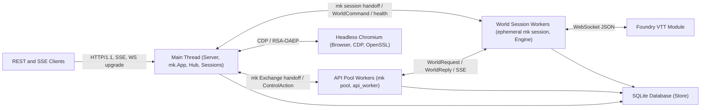

# Inside `foundry-relay`: Architecture and Implementation in Titan

`foundry-relay` is a single-user REST-to-WebSocket relay for the Foundry VTT REST API module, written in [Titan](https://github.com/mascarenhas/titan) on top of [`titan-mk`](https://github.com/mascarenhas/mk). The production server spans 20 flat Titan modules totaling 4,555 lines—[`foundry_relay.titan`](../foundry_relay.titan) plus 19 modules under `relay/`—verified by 15 native `titan.test` suites (5,522 lines). Production modules use zero `.titan` source imports; every internal boundary compiles through ordinary Titan module interfaces.

As a compact systems application, `foundry-relay` exercises Titan's concurrency, data-modeling, and native-interop facilities under real operational constraints: `titan-mk` worker pools and ephemeral per-session OS threads communicating over bounded typed channels, cooperative FIFO ownership gates built on `async.ResumeToken`, `mk.router` PEG routing and middleware composition, closed tagged-union request translation, lossless JSON null preservation, cooperative SQLite transactions, and a narrow OpenSSL C FFI and Chrome DevTools Protocol boundary. Each chapter walks through one layer of the relay, pairing design constraints with the Titan code that implements them.

For deployment, operator environment variables, REST route contracts, and headless client setup, consult the task-oriented guides:

- [Configuration, Deployment, and Logging](configuration.md)
- [HTTP and WebSocket API](api.md)
- [Headless Foundry Sessions](sessions.md)

## System architecture

Three OS thread roles divide the server so no shared Lua heap or garbage collector spans threads. The **main thread** runs the `mk.App` HTTP listener and worker supervisor, owns the live world directory (`Hub`), coordinates headless browser sessions (`Manager`), and writes structured JSON logs to `stderr` via `mk.log`. Persistent **`mk` pool workers** (`WorkerMode.pool`) handle REST requests, enforce origin and API-key policy, translate 91 upstream REST routes, and serve Server-Sent Events (SSE). Per-connection **ephemeral session workers** (`WorkerMode.session` with `ephemeral = true`) own one authenticated Foundry WebSocket each, managing framing, heartbeats, request correlation, and non-blocking event fanout. Every thread attaches its own cooperative SQLite `Store` handle to the shared database file.

## Codebase map

The 20 flat production modules divide into five architectural layers.

### 1. Entrypoint and supervisor

- `foundry_relay` ([`foundry_relay.titan`](../foundry_relay.titan)) — Standalone async entrypoint (named `foundry_relay` rather than `main` so Windows avoids `main.dll` collisions in shared `lib/titan/0.6`), `RELAY_LOG_LEVEL` bootstrap via `mk.log`, `SIGINT`/`SIGTERM` signal Tasks, and exit-code propagation.
- `relay.server` ([`relay/server.titan`](../relay/server.titan)) — Owns the `mk.App`, `world_slots`, `Hub`, `Store`, headless `Manager`, coordinator loop, `on_exit` world retirement, and `on_pre_shutdown`/`on_post_shutdown` cleanup hooks.
- `relay.messages` ([`relay/messages.titan`](../relay/messages.titan)) — Cross-thread `ControlAction` (16 variants), `ControlReply` (7 variants), and `ControlRequest` DTOs carrying data and channel endpoints (no raw transports).
- `relay.control` ([`relay/control.titan`](../relay/control.titan)) — Request/reply coordinator RPC (`call`) and cancellation-shielded `notify` for `cancel`, `claim`, `unsubscribe`, and `session_discard`.
- `relay.tasks` ([`relay/tasks.titan`](../relay/tasks.titan)) — Cancellation-shielded `await_terminal`, `drain`, and `await_retirement` helpers over `async.await_cleanup`.

### 2. Live world directory and transport

- `relay.world_protocol` ([`relay/world_protocol.titan`](../relay/world_protocol.titan)) — Cross-thread world addressing (`WorldHandle`), `WorldRequest`/`WorldReply`, `WorldCommand`, SSE `Subscription`/`SubscriptionTarget`, `Activation`, and `SSE_CHANNELS`.
- `relay.hub` ([`relay/hub.titan`](../relay/hub.titan)) — Main-thread live world directory, Task-reentrant FIFO `Hub:transition` gate, two-step reconnect quiescence with post-quiescence `can_publish` revalidation, and persistent SSE subscriber registry.
- `relay.replies` ([`relay/replies.titan`](../relay/replies.titan)) — Per-worker `Pool` of reusable reply-channel leases, FIFO `ResumeToken` admission, `async.race_three` correlation, and stale-channel replacement.
- `relay.world` ([`relay/world.titan`](../relay/world.titan)) — Ephemeral per-world `mk` session worker (`select_session`, `initializer`, `handle_relay`) and `Engine`: `ctx:upgrade_websocket`, WebSocket auth, `BufferedSubscription` outbox, `Outgoing:should_send` pre-write check, heartbeats, and non-blocking SSE fanout.

### 3. HTTP routing, wire JSON, and REST workers

- `relay.routes` ([`relay/routes.titan`](../relay/routes.titan)) — Builds the `mk.App` with `WorkerMode.pool` (REST/SSE) and ephemeral `WorkerMode.session` (`/relay`), global admission logging (`mk.middleware.logger`), `origin_policy`, `reject_malformed_target`, `mk.middleware.recover`, per-route `mk.middleware.keyauth`, and 17 local routes ahead of 91 upstream forwarding routes.
- `relay.wire` ([`relay/wire.titan`](../relay/wire.titan)) — Lossless JSON `decode`/`encode` over a private zero-field `Null` sentinel and hoisted 16 MiB / depth-64 option constants.
- `relay.api` ([`relay/api.titan`](../relay/api.titan)) — Closed-union catalog (`ParamKind`, `ParamSource`, `EndpointKind`) for all 91 upstream endpoints, coercion, cross-field validation, and Base64 binary framing.
- `relay.api_worker` ([`relay/api_worker.titan`](../relay/api_worker.titan)) — `mk` pool-worker `initializer` (`Store` + 4-lease reply `Pool` with `wctx:defer_cleanup`), plain REST handlers, two-phase headless session publication, and 15-second keepalive SSE streaming.

### 4. Persistence, configuration, and logging

- `relay.store` ([`relay/store.titan`](../relay/store.titan)) — Mode-`0600` SQLite initialization (`open`) vs. schema-free worker handles (`attach`), per-thread FIFO ownership, `BEGIN IMMEDIATE` transactions, cooperative `SQLITE_BUSY` retry, and `uv.random` tokens.
- `relay.config` ([`relay/config.titan`](../relay/config.titan)) — Fail-fast environment loading into an immutable `Config`, length-hiding bitwise `secret_equal`, and shared origin checks (`request_origin_allowed`).
- Structured logging (`mk.log` and `mk.middleware.logger`) — Provided by `titan-mk`: non-suspending JSON `stderr` `Logger`, automatic cross-thread worker log forwarding, `log_dropped` accounting, and admission-phase `http_request` logging.

### 5. Headless sessions, browser, and OpenSSL FFI

- `relay.session_crypto` ([`relay/session_crypto.titan`](../relay/session_crypto.titan)) — Public `Key` interface hiding OpenSSL `EVP_PKEY` behind `NativeKey`, `gc.finalizable` fallback, stack C arrays, `OPENSSL_cleanse`, and counted string extraction.
- `relay.cdp` ([`relay/cdp.titan`](../relay/cdp.titan)) — Single-flight Chrome DevTools Protocol transport over `titan.websocket` with per-call deadline abortion and boundary error scrubbing.
- `relay.browser` ([`relay/browser.titan`](../relay/browser.titan)) — Disposable `uv.fs_mkdtemp` Chrome profiles, env-scrubbed `os.spawn`, Windows `EBUSY` endpoint polling, off-the-record browser contexts, and Flatpak-safe multi-stage retirement.
- `relay.foundry_session` ([`relay/foundry_session.titan`](../relay/foundry_session.titan)) — Origin-gated `Page.addScriptToEvaluateOnNewDocument` hook, join-form automation, allowlisted `world-info` metadata, and exact `hub.Session` ownership checks.
- `relay.sessions` ([`relay/sessions.titan`](../relay/sessions.titan)) — Single-use RSA-OAEP handshakes, synchronous world reservation, `EntryState` lifecycle, finite `StartupFailure` classification, and two-phase HTTP publication.

## Titan feature showcase matrix

Use this index to jump directly to a Titan language or standard-library pattern in production code.

| Titan idiom | Modules and symbols | Book reference |
| --- | --- | --- |
| Standalone async entrypoint and signal Tasks (`os.wait_signal`, `async.run`) | `main`, `run` ([`foundry_relay.titan`](../foundry_relay.titan)) | [Ch. 1](threading.md) |
| `titan-mk` worker pools, ephemeral session workers, and lifecycle hooks | `create` ([`relay/routes.titan`](../relay/routes.titan)), `Server.new`, `publish_world`, `world_exited` ([`relay/server.titan`](../relay/server.titan)) | [Ch. 1](threading.md) |
| Typed cross-thread RPC over bounded MPMC channels (`thread.channel`, endpoint transfer) | `ControlAction`, `ControlReply` ([`relay/messages.titan`](../relay/messages.titan)), `call`, `notify` ([`relay/control.titan`](../relay/control.titan)) | [Ch. 1](threading.md) |
| Fixed-arity task races and shielded cleanup (`async.race_three`, `async.await_cleanup`, `defer`) | `Pool:wait_reply` ([`relay/replies.titan`](../relay/replies.titan)), `await_terminal`, `await_retirement` ([`relay/tasks.titan`](../relay/tasks.titan)) | [Ch. 1](threading.md) |
| Cooperative FIFO gates with `async.ResumeToken` and `async.suspend` | `Hub:acquire` ([`relay/hub.titan`](../relay/hub.titan)), `Pool:acquire` ([`relay/replies.titan`](../relay/replies.titan)), `Store:acquire` ([`relay/store.titan`](../relay/store.titan)) | [Ch. 1](threading.md), [Ch. 3](persistence-and-logging.md) |
| `mk` middleware pipeline, PEG routing, and JSON error mapping | `create`, `origin_policy`, `relay_error` ([`relay/routes.titan`](../relay/routes.titan)), `serve_stream` ([`relay/api_worker.titan`](../relay/api_worker.titan)) | [Ch. 2](routing.md) |
| Closed tagged unions, unit singletons, `const {T}`, and exhaustive `case` dispatch | `ParamKind`, `ParamSource`, `EndpointKind`, `catalog` ([`relay/api.titan`](../relay/api.titan)), `EntryState` ([`relay/sessions.titan`](../relay/sessions.titan)) | [Ch. 2](routing.md), [Ch. 4](headless-sessions.md) |
| Lossless JSON null sentinels and record encoding (`json.DecodeOption.null_value`) | `Null`, `ErrorEnvelope` ([`relay/wire.titan`](../relay/wire.titan)) | [Ch. 2](routing.md) |
| Non-suspending `async.BufferedSubscription` producer/consumer queues | `Engine` (`outbox`) ([`relay/world.titan`](../relay/world.titan)) | [Ch. 1](threading.md) |
| Asynchronous `sqlite3` transactions and synchronous `get_autocommit` rollback guards | `retry_operation`, `Store:pair` ([`relay/store.titan`](../relay/store.titan)) | [Ch. 3](persistence-and-logging.md) |
| Nominal `interface` encapsulation, OpenSSL C FFI, stack C arrays, and `gc.finalizable` | `Key`, `NativeKey`, `generate`, `NativeKey:decrypt` ([`relay/session_crypto.titan`](../relay/session_crypto.titan)) | [Ch. 4](headless-sessions.md) |
| LuaRocks packaging, native `titan.test` suites, white-box `.titan` test imports, and dual-tree `--coverage` | [`foundry-relay-0.1.0-1.rockspec`](../foundry-relay-0.1.0-1.rockspec), [`scripts/rock-test.lua`](../scripts/rock-test.lua), [`tests/threading_test.titan`](../tests/threading_test.titan) | [App. A](build-and-testing.md), [App. B](coverage.md) |
## Table of contents

### Usage guides

- **[Configuration, Deployment, and Logging](configuration.md)** — Core environment variables, pairing and token rotation, reverse-proxy TLS and `Origin` policy, SQLite `0600` permissions, structured `stderr` logs, and shutdown behavior.
- **[HTTP and WebSocket API](api.md)** — Local routes, pairing and `/relay` authentication, event streams, parameter coercion, binary upload/download framing, deadlines, and all 91 forwarding routes.
- **[Headless Foundry Sessions](sessions.md)** — Chromium and Flatpak profile setup, RSA-2048 OAEP credential handshakes, runnable Node.js and Python clients, and startup failure diagnostics.

### Implementation chapters

1. **[Chapter 1: Multi-Threaded Architecture, Channel Ownership, and World Lifecycle](threading.md)** — Three OS thread roles over `titan-mk` worker pools and ephemeral sessions, signal-safe startup and shielded retirement, reusable reply-channel lease pools, typed coordinator RPC, and two-step reconnect quiescence.
2. **[Chapter 2: Declarative Routing, Request Translation, and Event Streaming](routing.md)** — `titan-mk` middleware and PEG route composition, lossless JSON `Null` sentinels, closed-union REST catalog translation, Base64 binary framing, and keepalive SSE fanout.
3. **[Chapter 3: Cooperative SQLite Persistence, Configuration, and Structured Logging](persistence-and-logging.md)** — Immutable configuration with length-hiding secret comparison, `0600` database initialization, FIFO `Store` handles, `BEGIN IMMEDIATE` cooperative retry on `SQLITE_BUSY`, and `mk.log` structured logging.
4. **[Chapter 4: Headless Browser Automation and the OpenSSL FFI Boundary](headless-sessions.md)** — OpenSSL RSA-2048 OAEP behind a nominal `Key` interface, single-flight CDP transport, disposable profiles with Flatpak-safe retirement, Foundry preload binding, and two-phase session publication.

### Engineering appendices

- **[Appendix A: Native Builds, Windows Packaging, Testing, and Retired Records](build-and-testing.md)** — LuaRocks `titanc --static` POSIX builds, Windows rockspec and MSYS2 CLANG64 relocatable DLL packaging, the 15-module native test suite, provenance, and archived validation permalinks.
- **[Appendix B: Executable Line Coverage](coverage.md)** — Dual-tree `luarocks test -- --coverage` builds separating the test runner from child-process server coverage and generating `.coverage/report/coverage.gcov`.
