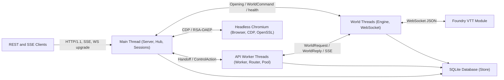

# Inside `foundry-relay`: Architecture and Implementation in Titan

`foundry-relay` is a single-user REST-to-WebSocket relay for the Foundry VTT REST API module, written in [Titan](https://github.com/mascarenhas/titan). The production server spans 22 flat Titan modules totaling 5,222 lines—`main.titan` plus 21 modules under `relay/`—verified by 17 native `titan.test` suites (5,905 lines). Production modules use zero `.titan` source imports; every internal boundary compiles through ordinary Titan module interfaces.

As a compact systems application, `foundry-relay` exercises Titan's concurrency, data-modeling, and native-interop facilities under real operational constraints: isolated OS threads communicating exclusively over bounded typed channels, manual native HTTP socket handoff, cooperative FIFO ownership gates built on `async.ResumeToken`, two-stage Relabel PEG routing, closed tagged-union request translation, lossless JSON null preservation, cooperative SQLite transactions, and a narrow OpenSSL C FFI and Chrome DevTools Protocol boundary. Each chapter walks through one layer of the relay, pairing design constraints with the Titan code that implements them.

For deployment, operator environment variables, REST route contracts, and headless client setup, consult the task-oriented guides:

- [Configuration, Deployment, and Logging](configuration.md)
- [HTTP and WebSocket API](api.md)
- [Headless Foundry Sessions](sessions.md)

## System architecture

Three OS thread roles divide the server so no shared Lua heap or garbage collector spans threads. The **main thread** accepts HTTP connections, owns the live world directory (`Hub`), coordinates headless browser sessions (`Manager`), and writes structured JSON logs to `stderr`. Persistent **API worker threads** parse requests, enforce origin and API-key policy, translate 91 upstream REST routes, and serve Server-Sent Events (SSE). Per-connection **world threads** own one authenticated Foundry WebSocket each, managing framing, heartbeats, request correlation, and non-blocking event fanout. Every thread attaches its own cooperative SQLite `Store` handle to the shared database file.

## Codebase map

The 22 flat production modules divide into five architectural layers.

### 1. Entrypoint and supervisor

- `main` ([`main.titan`](../main.titan)) — Standalone async entrypoint, `RELAY_LOG_LEVEL` bootstrap, `SIGINT`/`SIGTERM` signal Tasks, and exit-code propagation.
- `relay.server` ([`relay/server.titan`](../relay/server.titan)) — HTTP listener (`read_ahead(false)`), manual socket handoff, round-robin API worker dispatch, coordinator loop, worker monitors, and ordered shutdown.
- `relay.messages` ([`relay/messages.titan`](../relay/messages.titan)) — Cross-thread `ControlAction` (16 variants), `ControlReply` (7 variants), `ControlRequest`, and manually owned HTTP `Handoff` DTOs.
- `relay.control` ([`relay/control.titan`](../relay/control.titan)) — Request/reply coordinator RPC (`call`) and cancellation-shielded `notify` for `cancel`, `claim`, `unsubscribe`, and `session_discard`.
- `relay.tasks` ([`relay/tasks.titan`](../relay/tasks.titan)) — Cancellation-shielded `await_terminal`, `drain`, and `await_retirement` helpers over `async.await_cleanup`.

### 2. Live world directory and transport

- `relay.world_protocol` ([`relay/world_protocol.titan`](../relay/world_protocol.titan)) — Cross-thread world addressing (`WorldHandle`), `WorldRequest`/`WorldReply`, `WorldCommand`, SSE `Subscription`/`SubscriptionTarget`, `Activation`, and `SSE_CHANNELS`.
- `relay.hub` ([`relay/hub.titan`](../relay/hub.titan)) — Main-thread live world directory, Task-reentrant FIFO `Hub:transition` gate, two-step reconnect quiescence, and persistent SSE subscriber registry.
- `relay.replies` ([`relay/replies.titan`](../relay/replies.titan)) — Per-worker `Pool` of reusable reply-channel leases, FIFO `ResumeToken` admission, `async.race_three` correlation, and stale-channel replacement.
- `relay.world` ([`relay/world.titan`](../relay/world.titan)) — Isolated per-world thread and `Engine`: WebSocket auth, `BufferedSubscription` outbox, `Outgoing:should_send` pre-write check, heartbeats, and non-blocking SSE fanout.

### 3. HTTP routing, wire JSON, and REST workers

- `relay.router` ([`relay/router.titan`](../relay/router.titan)) — Relabel PEG declaration parser (`route_grammar`), anchored `peg.table_capture` route compiler, zero-allocation ASCII `percent_decode`, bounded `parse_target`, and `Resolution` matching.
- `relay.routes` ([`relay/routes.titan`](../relay/routes.titan)) — Precedence-ordered route table placing 17 local endpoints ahead of the 91 upstream forwarding routes.
- `relay.wire` ([`relay/wire.titan`](../relay/wire.titan)) — Lossless JSON `decode`/`encode` over a private zero-field `Null` sentinel and hoisted 16 MiB / depth-64 option constants.
- `relay.api` ([`relay/api.titan`](../relay/api.titan)) — Closed-union catalog (`ParamKind`, `ParamSource`, `EndpointKind`) for all 91 upstream endpoints, coercion, cross-field validation, and Base64 binary framing.
- `relay.api_worker` ([`relay/api_worker.titan`](../relay/api_worker.titan)) — Persistent HTTP worker loop, keep-alive handoff return, CORS/API-key enforcement, REST forwarding, and 15-second keepalive SSE streaming.

### 4. Persistence, configuration, and logging

- `relay.store` ([`relay/store.titan`](../relay/store.titan)) — Mode-`0600` SQLite initialization (`open`) vs. schema-free worker handles (`attach`), per-thread FIFO ownership, `BEGIN IMMEDIATE` transactions, cooperative `SQLITE_BUSY` retry, and `uv.random` tokens.
- `relay.config` ([`relay/config.titan`](../relay/config.titan)) — Fail-fast environment loading into an immutable `Config`, length-hiding bitwise `secret_equal`, and shared origin checks (`request_origin_allowed`).
- `relay.log` ([`relay/log.titan`](../relay/log.titan)) — Non-suspending `BufferedSubscription` JSON `stderr` logger, zero-Map `SimpleRecord` fast path, `log_dropped` accounting, and borrowed-`Sender` cross-thread forwarding.

### 5. Headless sessions, browser, and OpenSSL FFI

- `relay.session_crypto` ([`relay/session_crypto.titan`](../relay/session_crypto.titan)) — Public `Key` interface hiding OpenSSL `EVP_PKEY` behind `NativeKey`, `gc.finalizable` fallback, stack C arrays, `OPENSSL_cleanse`, and counted string extraction.
- `relay.cdp` ([`relay/cdp.titan`](../relay/cdp.titan)) — Single-flight Chrome DevTools Protocol transport over `titan.websocket` with per-call deadline abortion and boundary error scrubbing.
- `relay.browser` ([`relay/browser.titan`](../relay/browser.titan)) — Disposable `uv.fs_mkdtemp` Chrome profiles, env-scrubbed `os.spawn`, Windows `EBUSY` endpoint polling, off-the-record browser contexts, and Flatpak-safe multi-stage retirement.
- `relay.foundry_session` ([`relay/foundry_session.titan`](../relay/foundry_session.titan)) — Origin-gated `Page.addScriptToEvaluateOnNewDocument` hook, join-form automation, allowlisted `world-info` metadata, and exact `hub.Session` ownership checks.
- `relay.sessions` ([`relay/sessions.titan`](../relay/sessions.titan)) — Single-use RSA-OAEP handshakes, synchronous world reservation, `EntryState` lifecycle, finite `StartupFailure` classification, and two-phase HTTP publication.

## Titan feature showcase matrix

Use this index to jump directly to a Titan language or standard-library pattern in production code.

| Titan idiom | Modules and symbols | Book reference |
| --- | --- | --- |
| Standalone async entrypoint and signal Tasks (`os.wait_signal`, `async.run`) | `main`, `run` ([`main.titan`](../main.titan)) | [Ch. 1](threading.md) |
| OS threads and typed MPMC channels (`thread.spawn_one`, `thread.channel`, endpoint transfer) | `Server:start_api_workers`, `Server:start_world` ([`relay/server.titan`](../relay/server.titan)), `ControlAction`, `ControlReply` ([`relay/messages.titan`](../relay/messages.titan)) | [Ch. 1](threading.md) |
| Manual native HTTP socket handoff (`to_transfer_payload`, `discard_transfer_payload`) | `Handoff` ([`relay/messages.titan`](../relay/messages.titan)), `Server:deliver` ([`relay/server.titan`](../relay/server.titan)), `run` ([`relay/api_worker.titan`](../relay/api_worker.titan)) | [Ch. 1](threading.md), [Ch. 2](routing.md) |
| Fixed-arity task races and shielded cleanup (`async.race_three`, `async.await_cleanup`, `defer`) | `Pool:wait_reply` ([`relay/replies.titan`](../relay/replies.titan)), `await_terminal`, `await_retirement` ([`relay/tasks.titan`](../relay/tasks.titan)) | [Ch. 1](threading.md) |
| Cooperative FIFO gates with `async.ResumeToken` and `async.suspend` | `Hub:acquire` ([`relay/hub.titan`](../relay/hub.titan)), `Pool:acquire` ([`relay/replies.titan`](../relay/replies.titan)), `Store:acquire` ([`relay/store.titan`](../relay/store.titan)) | [Ch. 1](threading.md), [Ch. 3](persistence-and-logging.md) |
| Relabel PEG grammars and combinator pattern compilation (`peg.compile`, `peg.table_capture`) | `parse_route`, `compile_route` ([`relay/router.titan`](../relay/router.titan)) | [Ch. 2](routing.md) |
| Closed tagged unions, unit singletons, `const {T}`, and exhaustive `case` dispatch | `ParamKind`, `ParamSource`, `EndpointKind`, `catalog` ([`relay/api.titan`](../relay/api.titan)), `EntryState` ([`relay/sessions.titan`](../relay/sessions.titan)) | [Ch. 2](routing.md), [Ch. 4](headless-sessions.md) |
| Lossless JSON null sentinels and record encoding (`json.DecodeOption.null_value`) | `Null`, `ErrorEnvelope` ([`relay/wire.titan`](../relay/wire.titan)), `SimpleRecord` ([`relay/log.titan`](../relay/log.titan)) | [Ch. 2](routing.md), [Ch. 3](persistence-and-logging.md) |
| Non-suspending `async.BufferedSubscription` producer/consumer queues | `Engine` (`outbox`) ([`relay/world.titan`](../relay/world.titan)), `Logger` (`source`) ([`relay/log.titan`](../relay/log.titan)) | [Ch. 1](threading.md), [Ch. 3](persistence-and-logging.md) |
| Asynchronous `sqlite3` transactions and synchronous `get_autocommit` rollback guards | `retry_operation`, `Store:pair` ([`relay/store.titan`](../relay/store.titan)) | [Ch. 3](persistence-and-logging.md) |
| Nominal `interface` encapsulation, OpenSSL C FFI, stack C arrays, and `gc.finalizable` | `Key`, `NativeKey`, `generate`, `NativeKey:decrypt` ([`relay/session_crypto.titan`](../relay/session_crypto.titan)) | [Ch. 4](headless-sessions.md) |
| Native `titan.test` suites, white-box `.titan` test imports, and dual-tree `--coverage` | [`Makefile`](../Makefile), [`tests/threading_test.titan`](../tests/threading_test.titan), [`tests/replies_test.titan`](../tests/replies_test.titan) | [App. A](build-and-testing.md), [App. B](coverage.md) |

## Table of contents

### Usage guides

- **[Configuration, Deployment, and Logging](configuration.md)** — Core environment variables, pairing and token rotation, reverse-proxy TLS and `Origin` policy, SQLite `0600` permissions, structured `stderr` logs, and shutdown behavior.
- **[HTTP and WebSocket API](api.md)** — Local routes, pairing and `/relay` authentication, event streams, parameter coercion, binary upload/download framing, deadlines, and all 91 forwarding routes.
- **[Headless Foundry Sessions](sessions.md)** — Chromium and Flatpak profile setup, RSA-2048 OAEP credential handshakes, runnable Node.js and Python clients, and startup failure diagnostics.

### Implementation chapters

1. **[Chapter 1: Multi-Threaded Architecture, Channel Ownership, and World Lifecycle](threading.md)** — Three OS thread roles, signal-safe startup and shielded retirement, manual `http.Exchange` socket handoff, reusable reply-channel lease pools, typed coordinator RPC, and two-step reconnect quiescence.
2. **[Chapter 2: Declarative Routing, Request Translation, and Event Streaming](routing.md)** — Two-stage Relabel PEG routing, segment-preserving percent decoding, lossless JSON `Null` sentinels, closed-union REST catalog translation, Base64 binary framing, and keepalive SSE fanout.
3. **[Chapter 3: Cooperative SQLite Persistence, Configuration, and Structured Logging](persistence-and-logging.md)** — Immutable configuration with length-hiding secret comparison, `0600` database initialization, FIFO `Store` handles, `BEGIN IMMEDIATE` cooperative retry on `SQLITE_BUSY`, and non-suspending structured logging.
4. **[Chapter 4: Headless Browser Automation and the OpenSSL FFI Boundary](headless-sessions.md)** — OpenSSL RSA-2048 OAEP behind a nominal `Key` interface, single-flight CDP transport, disposable profiles with Flatpak-safe retirement, Foundry preload binding, and two-phase session publication.

### Engineering appendices

- **[Appendix A: Native Builds, Windows Packaging, Testing, and Retired Records](build-and-testing.md)** — Incremental `titanc --static` POSIX builds, MSYS2 CLANG64 Windows DLL packaging and relocation verification, the 17-module native test suite, provenance, and archived validation permalinks.
- **[Appendix B: Executable Line Coverage](coverage.md)** — Dual-tree `titanc --coverage` builds separating the test runner from child-process server coverage and generating `.coverage/report/coverage.gcov`.
